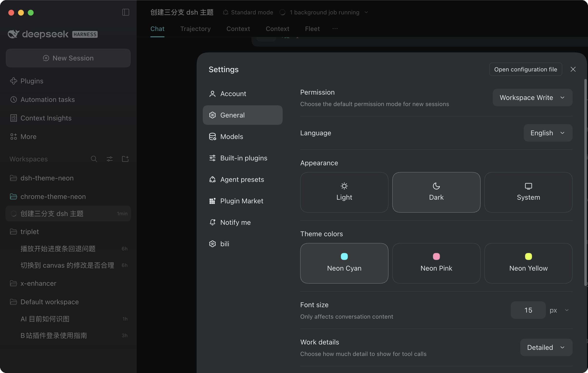

# Neon DSH Themes

Three neon palettes for **DeepSeek Harness (DSH)** — cyan, pink and yellow, one row in settings.

这是一个 **DeepSeek Harness (DSH) 小插件**：
在 `设置 → 通用设置` 的「外观」下面加一行「主题配色」，三个色块直接切换，
没有主题面板、导入导出或壁纸。

只做配色：neutral 色阶 + 强调色 + 语义色 + 边框 + 代码高亮。



## 三套配色

| ID | 名称 | 强调色（深色） | 浅色强调 | 说明 |
| --- | --- | --- | --- | --- |
| `neon-cyan` | Neon Cyan | `#54F5FF` | `#007A87` | 冰川霓虹青，冷调枪灰底 |
| `neon-pink` | Neon Pink | `#FF94B8` | `#B03A64` | 电气霓虹粉 |
| `neon-yellow` | Neon Yellow | `#E6FF40` | `#6E7C00` | 酸性荧光黄 |

共同基底：深色外观下 neutral 色阶从 `#F2F5F7` 收到 `#0A0B0D`（近黑冷底，不是纯黑），边框带一点主题色（alpha 7）；
浅色外观是一套独立的近白底，和 DSH 自带的「外观」开关共存——「外观」选深/浅/跟随系统，「主题配色」只决定用哪三色。

## 实现方式

- `themes/*.json` 是唯一真相源：每套配色只写种子（neutral 两端、accent/green/amber/red、border、shiki）。
- `scripts/build-client.mjs` 把种子按 DSH 预设的同一套算法展开成 CSS 变量，内联进 `lib/client.js`。
- 客户端插件在 `settings.general.item` 槽位注册一行（order `10.5`，紧跟「外观」），
  选中后给 `<html>` 加 `data-neon-palette="<id>"`，静态样式表按 `data-ds-dark-theme` 自动分浅色/深色。
- 选择存在 `localStorage` 的 `dsh-neon-palette` 里，刷新后仍在；不选则完全回到 DSH 默认。

## 安装 / 开发

```sh
git clone git@github.com:iShawnWang/dsh-theme-neon.git
cd dsh-theme-neon
npm run build        # 由 themes/*.json 生成 lib/client.js
npm run check        # 校验 lib/client.js 是否与 themes/*.json 同步
```

把仓库作为 `file:` 依赖挂进 DSH profile：

```sh
# ~/.dsh/profiles/desktop/package.json
#   dependencies: { "dsh-theme-neon": "file:/path/to/dsh-theme-neon" }
#   dsh.profile.bundles: [ ..., "dsh-theme-neon" ]
pnpm install --dir ~/.dsh/profiles/desktop
```

或者让 DSH 直接从 GitHub 安装这个插件：

```sh
dsh plugin add github:iShawnWang/dsh-theme-neon
```

刷新 DSH 窗口（必要时重启）。打开 `设置 → 通用设置`，在「外观」下面看到「主题配色」：
Neon Cyan / Neon Pink / Neon Yellow 三个色块，点一下即切换；「外观」仍然控制深色/浅色。

改配色时只改 `themes/*.json` 再 `npm run build`；DSH 重新加载插件后生效。

## 目录

```
themes/                  三套配色的种子 JSON
scripts/build-client.mjs 种子 → CSS 变量 → lib/client.js
lib/index.js             host 半（空实现，只为满足 profile bundle 结构）
lib/client.template.js   客户端插件源码（含占位符）
lib/client.js            生成物，提交进仓库，DSH 直接加载
cordis.patch.yml         profile patch，把插件挂进 bundle 列表
assets/icon-180.png      市场卡片图标
assets/screenshots/      设置页截图（深色三套 + 浅色一套）
screenshots.json         市场截图清单，路径相对仓库根
```

原始 Chrome 主题（Chrome 商店版本）在 [iShawnWang/chrome-theme-neon](https://github.com/iShawnWang/chrome-theme-neon)。

## License

[MIT](LICENSE) © 2026 Shawn Wang
