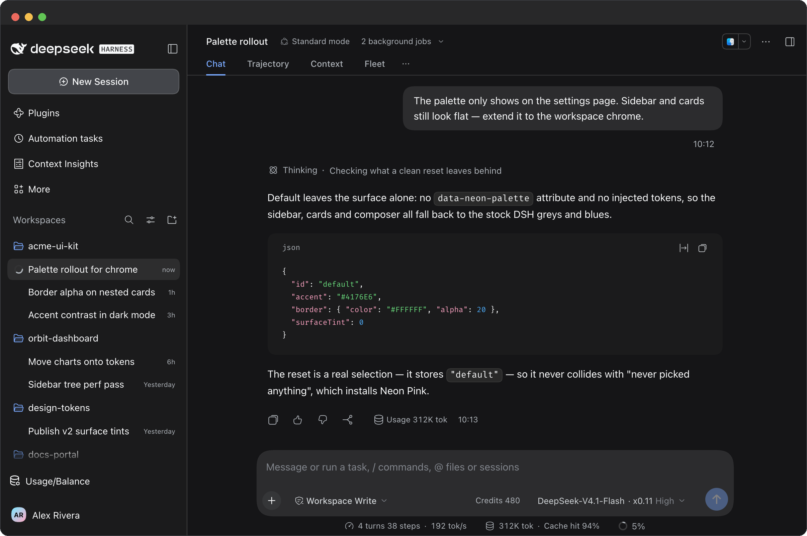
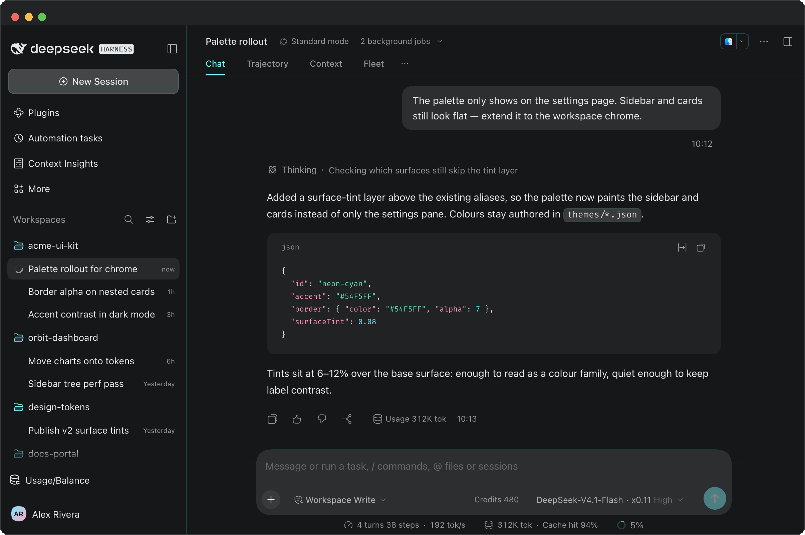
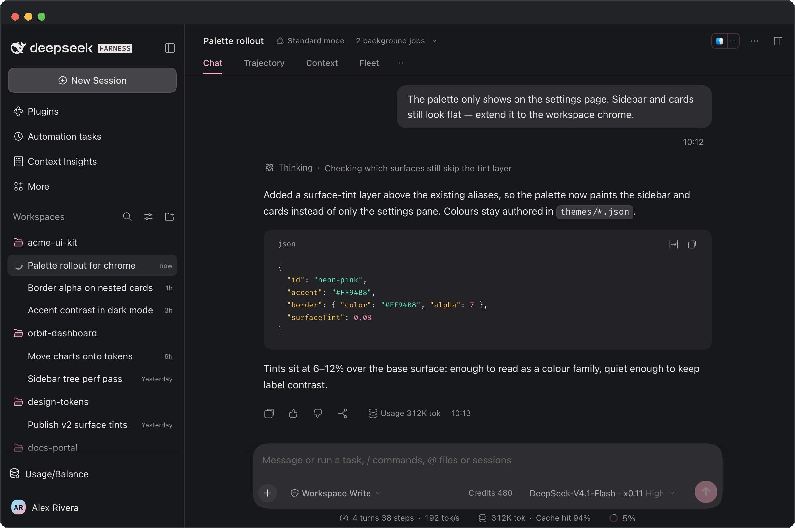
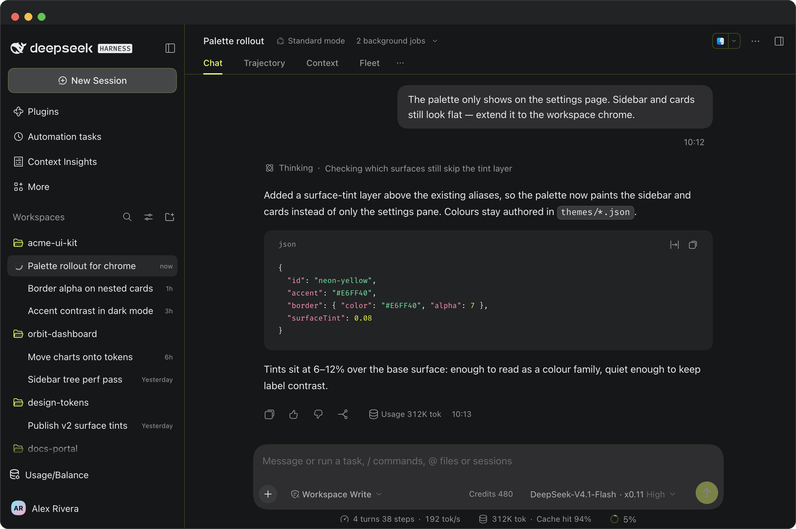

# Neon DSH Themes

**English** · [简体中文](README.zh-CN.md)

[](https://awesome-dsh-plugin.com)

Three neon themes for **DeepSeek Harness (DSH)** — cyan, pink and yellow — as one row of swatches in settings.

This is a small **DeepSeek Harness (DSH)** plugin:
it adds a **Theme colors** row under **Appearance** in `Settings → General`, with four swatches you click to switch.
No theme panel, import/export, or wallpapers.

Colors only: neutral scale + accent + semantic colors + borders + syntax highlighting.

## Authentic to the shell, restrained in colour

- **Nothing is restyled.** Each palette is expanded with the same algorithm DSH uses for its own presets, so spacing, radii, ramps and token relationships stay exactly where the shell put them — only the hue changes.
- **Restraint over decoration.** No wallpaper, no gradient, no glow on hover. Panels and cards keep the neutral grey ramp — the accent is spent on the things you actually aim at: the accent scale behind primary buttons and focus rings, the active nav indicator, and the border tint. Labels and body text stay neutral, so an eight-hour session still reads like a text editor rather than a neon sign.
- **Near-black, never black.** Dark appearance bottoms out at `#0A0B0D` — a cool near-black — so the accents sit on something with depth instead of clipping into `#000`.
- **Borders you feel more than see.** The seed carries only 6–7% alpha, tinted with the palette's own colour; the derived ramp tops out at 21%, so cards and inputs gain an edge rather than a line.
- **Two appearances, one palette.** Every palette ships a dark and a light token set. The shell's **Appearance** switch keeps working and the palette follows it.
- **Syntax inside the same family.** The nine highlight tokens are authored per palette from that palette's own accent / green / amber / red rather than borrowed from an off-the-shelf theme, so a code block never imports a second colour language.

## Side by side

Same workspace, same mock conversation, four different selections — the only thing that changes is which swatch is active. A fresh install lands on **Neon Pink**.

**Default** — the shell as shipped.



**Neon Cyan** — the quietest of the three. Arctic cyan `#54F5FF` on gunmetal; it reads as a cold tint in the chrome and leaves the prose alone.



**Neon Pink** — the warmest. Electric pink `#FF94B8` shows up in the selected row, the send button and the caret, not in the body text.



**Neon Yellow** — the loudest and the highest contrast. Acid yellow `#E6FF40` sits close to ink on black; best in a bright room or a dim one, worst for long reads.



| ID | Name | Accent (dark) | Accent (light) | Character |
| --- | --- | --- | --- | --- |
| `default` | Default | DSH built-in | DSH built-in | The shell's own palette |
| `neon-cyan` | Neon Cyan | `#54F5FF` | `#007A87` | Clinical and cool — cyan over gunmetal |
| `neon-pink` | Neon Pink | `#FF94B8` | `#B03A64` | Warm and soft — glow without shouting |
| `neon-yellow` | Neon Yellow | `#E6FF40` | `#6E7C00` | Bold and high-contrast — ink on black |

Shared base: in dark appearance the neutral scale runs from `#F2F5F7` down to `#0A0B0D` (a near-black cool base, not pure black), and borders carry a hint of the palette color (alpha 7).
Light appearance has its own near-white base and coexists with DSH's built-in **Appearance** switch — **Appearance** chooses dark / light / follow-system, **Theme colors** only picks which palette is active.

`assets/screenshots/` also holds one settings-page shot per palette (`*-dark-en.png`, plus `neon-cyan-light-en.png` for the light appearance), so you can see where the swatches live.

## How it works

- `themes/*.json` is the single source of truth: each palette stores only seeds (neutral endpoints, accent/green/amber/red, border, shiki).
- `scripts/build-client.mjs` expands the seeds into CSS variables with the same algorithm as the DSH presets and inlines them into `lib/client.js`.
- Surface fills stay neutral: `--dsw-specific-sidebar-fill` and the whole `neutral` / `neutral-bluish` ramp come from the palette's own grey endpoints, so the canvas never turns into a colour panel. The palette reaches the UI through the `deepseek` accent scale, the border tint and the nine shiki tokens instead.
- The client plugin registers a row in the `settings.general.item` slot (order `10.5`, right after Appearance). Selecting a palette adds `data-neon-palette="<id>"` to `<html>`, and the static stylesheet switches between light and dark based on `data-ds-dark-theme`.
- The selection is stored under `dsh-neon-palette` in `localStorage` and survives a refresh. A fresh install lands on **Neon Pink**.

## Install / develop

```sh
git clone git@github.com:iShawnWang/dsh-theme-neon.git
cd dsh-theme-neon
npm run build        # generate lib/client.js from themes/*.json
npm run check        # verify lib/client.js is in sync with themes/*.json
```

Mount the repo as a `file:` dependency in your DSH profile:

```sh
# ~/.dsh/profiles/desktop/package.json
#   dependencies: { "dsh-theme-neon": "file:/path/to/dsh-theme-neon" }
#   dsh.profile.bundles: [ ..., "dsh-theme-neon" ]
pnpm install --dir ~/.dsh/profiles/desktop
```

Or let DSH install the plugin directly from GitHub:

```sh
dsh plugin add github:iShawnWang/dsh-theme-neon
```

Refresh the DSH window (restart if needed). Open `Settings → General` and you will find **Theme colors** below **Appearance**:
Default / Neon Cyan / Neon Pink / Neon Yellow — click one to switch; **Appearance** still controls dark / light.

To change colors, edit `themes/*.json` and run `npm run build`; the plugin picks it up when DSH reloads it.

## Layout

```
themes/                  seed JSON, one per palette
scripts/build-client.mjs seeds → CSS variables → lib/client.js
lib/index.js             host half (empty; keeps the profile bundle structure valid)
lib/client.template.js   client plugin source (with placeholders)
lib/client.js            generated, committed, loaded by DSH directly
cordis.patch.yml         profile patch that adds the plugin to the bundle list
assets/icon-180.png      market card icon
assets/screenshots/      four workspace shots (dark) + four settings shots (three dark, one light)
screenshots.json         market screenshot manifest, paths relative to repo root
```

The original Chrome theme (the Chrome Web Store release) lives in [iShawnWang/chrome-theme-neon](https://github.com/iShawnWang/chrome-theme-neon).

## License

[MIT](LICENSE) © 2026 Shawn Wang
