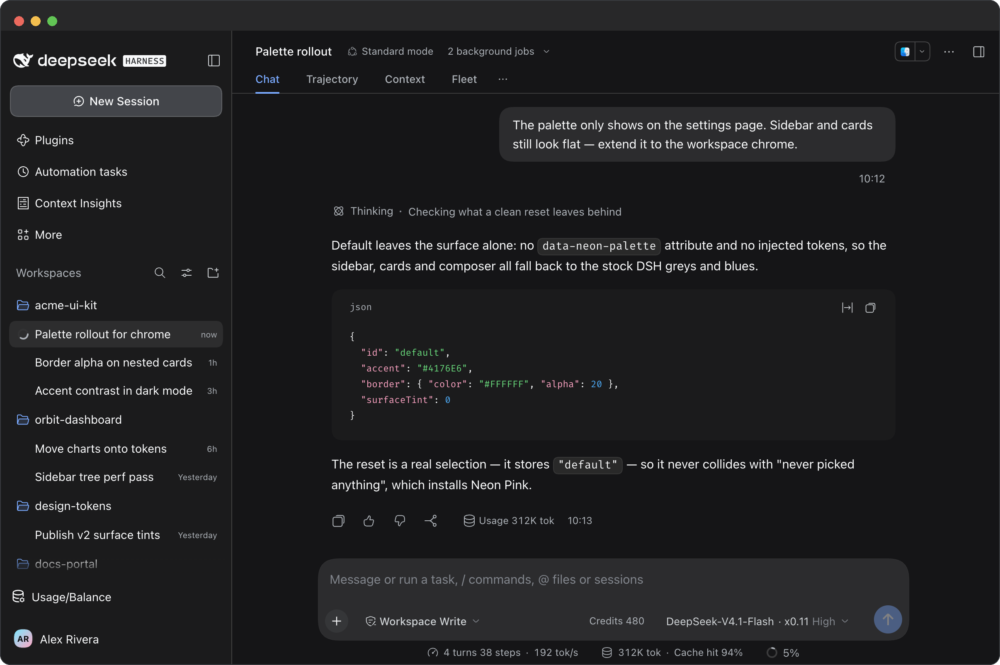
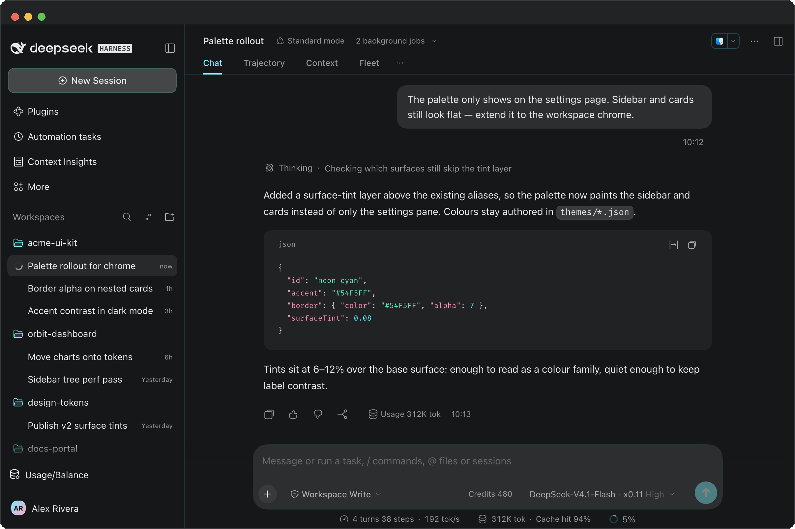
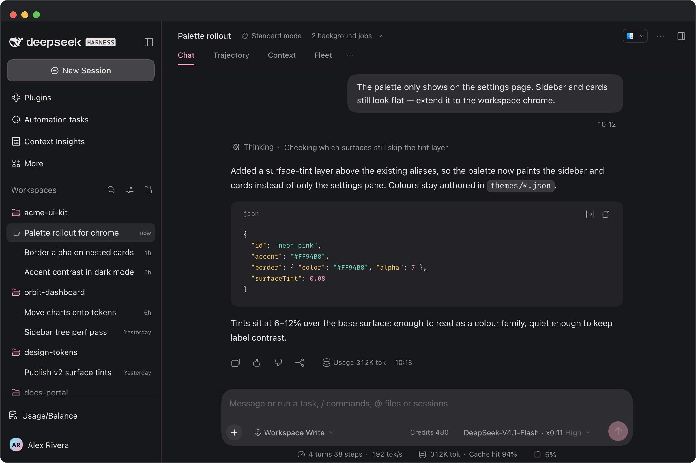
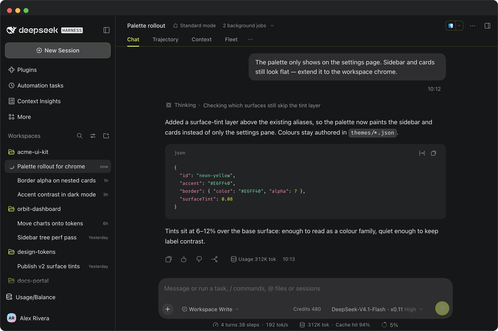

# Neon DSH Themes

[English](README.md) · **简体中文**

[](https://awesome-dsh-plugin.com)

给 **DeepSeek Harness (DSH)** 的三套霓虹主题——青、粉、黄——在设置里只占一行。

这是一个 **DeepSeek Harness (DSH) 小插件**：
在 `设置 → 通用设置` 的「外观」下面加一行「主题配色」，四个色块直接切换，
没有主题面板、导入导出或壁纸。

只做配色：neutral 色阶 + 强调色 + 语义色 + 边框 + 代码高亮。

## 原汁原味，简约克制

- **不改结构，只改色相。** 每套配色都按 DSH 自己的预设算法展开，间距、圆角、色阶关系和 token 之间的对应都留在原位，动的只有颜色。
- **克制，不加装饰。** 没有壁纸、没有渐变、悬停也不发光。面板和卡片老老实实走中性灰阶，强调色只花在你真正会去点的东西上：主按钮和焦点环背后的强调色阶、侧边栏的选中指示条、以及边框的那点染色。label 和正文一律保持中性，所以连开八小时它读起来还像文本编辑器，不像霓虹灯。
- **近黑，不是纯黑。** 深色外观最低收到 `#0A0B0D` 这个冷调近黑，强调色才有底子可站，不会直接陷进 `#000`。
- **边框是感觉出来的，不是看出来的。** 种子只给 6–7% 的 alpha，还带一点主题色，展开后最高也只到 21%，卡片和输入框多一道边，而不是多一条线。
- **两种外观，同一套配色。** 每套配色都有深浅两版 token；shell 的「外观」开关照常工作，配色跟着走。
- **高亮跟主色一个色系。** 九个语法 token 是照着该套配色自己的强调色/绿/琥珀/红单独定出来的，不是套现成的第三方主题，代码块不会突然冒出第二种配色语言。

## 四选一对比

同一个工作区、同一段 mock 对话，只换选中的色块。装完插件默认激活 **Neon Pink**。

**默认**——shell 出厂的样子。



**Neon Cyan**——三套里最安静的。冰川青 `#54F5FF` 落在枪灰底上，界面像蒙了层冷调，正文完全不动。



**Neon Pink**——最暖的一套。电气粉 `#FF94B8` 只出现在选中行、发送键和光标上，不进正文。



**Neon Yellow**——最亮、对比度最高。酸性黄 `#E6FF40` 贴在黑上接近墨色；亮房间暗房间都够用，长时间读最费眼。



| ID | 名称 | 强调色（深色） | 强调色（浅色） | 性格 |
| --- | --- | --- | --- | --- |
| `default` | 默认 | DSH 自带 | DSH 自带 | shell 自带色板 |
| `neon-cyan` | Neon Cyan | `#54F5FF` | `#007A87` | 冷静克制——枪灰底上的一抹青 |
| `neon-pink` | Neon Pink | `#FF94B8` | `#B03A64` | 柔和温暖——会发光，但不吵 |
| `neon-yellow` | Neon Yellow | `#E6FF40` | `#6E7C00` | 大胆高对比——黑底上的墨色

共同基底：深色外观下 neutral 色阶从 `#F2F5F7` 收到 `#0A0B0D`（近黑冷底，不是纯黑），边框带一点主题色（alpha 7）；
浅色外观是一套独立的近白底，和 DSH 自带的「外观」开关共存——「外观」选深/浅/跟随系统，「主题配色」只决定用哪套。

`assets/screenshots/` 里另外还有每套配色一张设置页截图（`*-dark-en.png`，浅色外观另有一张 `neon-cyan-light-en.png`），可以看到色块放在哪。

## 实现方式

- `themes/*.json` 是唯一真相源：每套配色只写种子（neutral 两端、accent/green/amber/red、border、shiki）。
- `scripts/build-client.mjs` 把种子按 DSH 预设的同一套算法展开成 CSS 变量，内联进 `lib/client.js`。
- 表面填充保持中性：`--dsw-specific-sidebar-fill` 和整条 `neutral` / `neutral-bluish` 色阶都来自该套配色自己的灰色两端，所以画布不会变成一块彩色面板。配色是通过 `deepseek` 强调色阶、边框染色和九个 shiki token 走进界面的。
- 客户端插件在 `settings.general.item` 槽位注册一行（order `10.5`，紧跟「外观」），
  选中后给 `<html>` 加 `data-neon-palette="<id>"`，静态样式表按 `data-ds-dark-theme` 自动分浅色/深色。
- 选择存在 `localStorage` 的 `dsh-neon-palette` 里，刷新后仍在。装完插件默认落在 **Neon Pink**。

## 安装 / 开发

```sh
git clone git@github.com:iShawnWang/dsh-theme-neon.git
cd dsh-theme-neon
npm run build        # 由 themes/*.json 生成 lib/client.js
npm run check        # 校验 lib/client.js 是否与 themes/*.json 同步
```

把仓库作为 `file:` 依赖挂进 DSH profile：

```sh
# ~/.dsh/profiles/desktop/package.json
#   dependencies: { "dsh-theme-neon": "file:/path/to/dsh-theme-neon" }
#   dsh.profile.bundles: [ ..., "dsh-theme-neon" ]
pnpm install --dir ~/.dsh/profiles/desktop
```

或者让 DSH 直接从 GitHub 安装这个插件：

```sh
dsh plugin add github:iShawnWang/dsh-theme-neon
```

刷新 DSH 窗口（必要时重启）。打开 `设置 → 通用设置`，在「外观」下面看到「主题配色」：
默认 / Neon Cyan / Neon Pink / Neon Yellow 四个色块，点一下即切换；「外观」仍然控制深色/浅色。

改配色时只改 `themes/*.json` 再 `npm run build`；DSH 重新加载插件后生效。

## 目录

```
themes/                  种子 JSON，一套配色一个
scripts/build-client.mjs 种子 → CSS 变量 → lib/client.js
lib/index.js             host 半（空实现，只为满足 profile bundle 结构）
lib/client.template.js   客户端插件源码（含占位符）
lib/client.js            生成物，提交进仓库，DSH 直接加载
cordis.patch.yml         profile patch，把插件挂进 bundle 列表
assets/icon-180.png      市场卡片图标
assets/screenshots/      工作区截图（深色四张）+ 设置页截图（深色三张 + 浅色一张）
screenshots.json         市场截图清单，路径相对仓库根
```

原始 Chrome 主题（Chrome 商店版本）在 [iShawnWang/chrome-theme-neon](https://github.com/iShawnWang/chrome-theme-neon)。

## License

[MIT](LICENSE) © 2026 Shawn Wang
